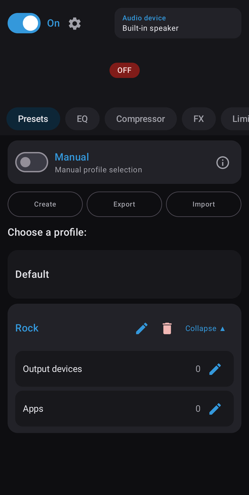
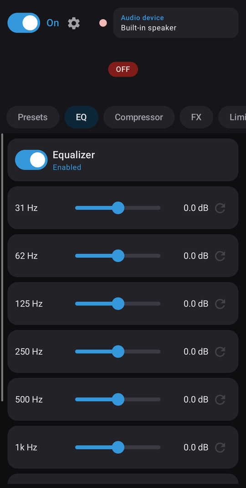
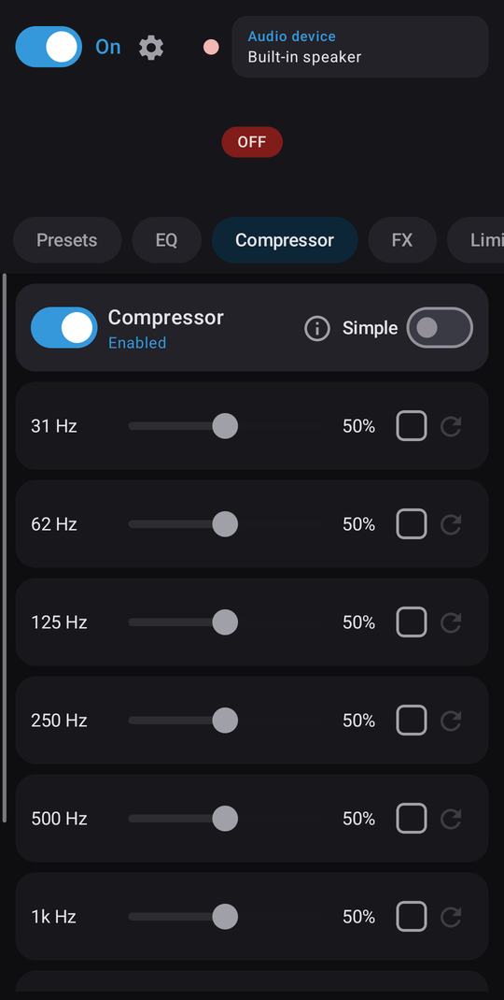
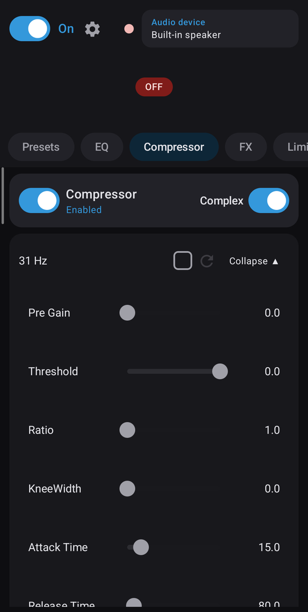
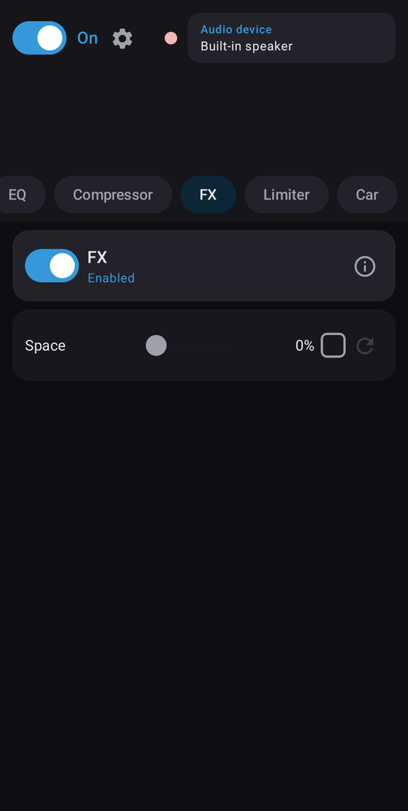
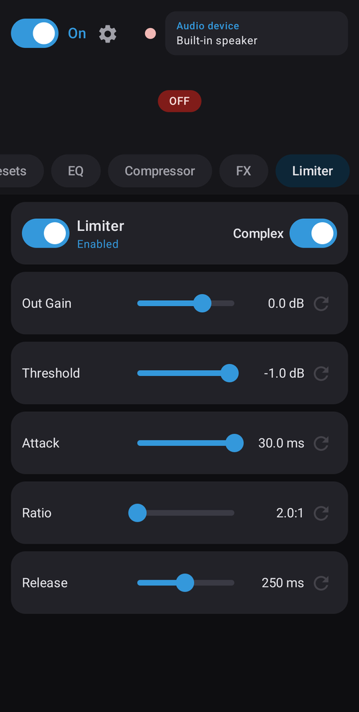
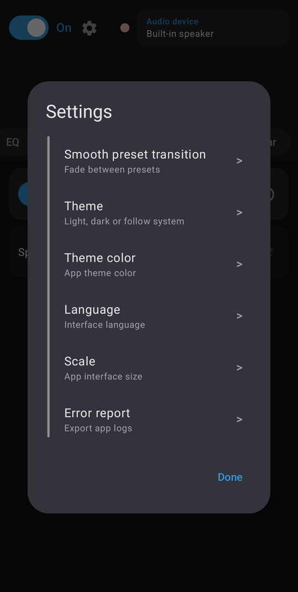
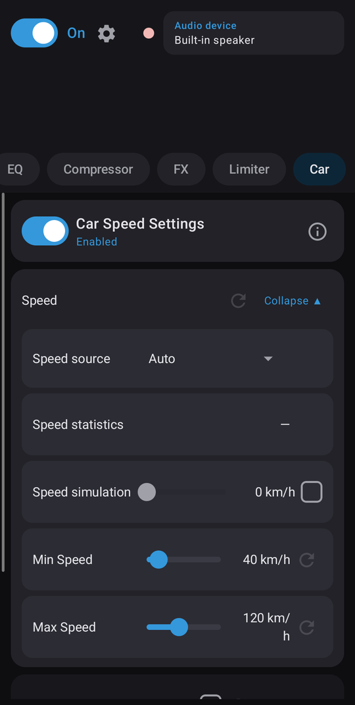
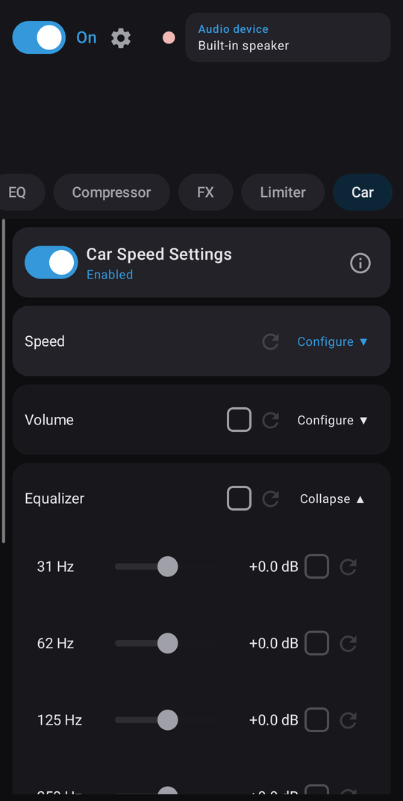

# equX

**English** | [Русский](README.ru.md)

System-wide audio equalizer and DSP for Android phones and Android-based car head units.
No root required.

equX applies its effect chain to the global audio session (session 0), so it works with any
player, including apps that don't open their own audio-effect session.

## Features

- **Equalizer**: parametric post-EQ with per-band frequency and gain.
- **Compressor**: multiband dynamics. *Simple* mode has a single intensity slider, *Complex* mode has per-band threshold, ratio and gains.
- **Limiter**: brickwall output protection, also with Simple and Complex modes.
- **FX**:
  - *Space*: system Virtualizer + 1–16 kHz treble lift.
  - *Low-Volume Boost* (loudness compensation): at low system volume raises bass and treble following the ISO 226:2003 equal-loudness contours. Adjustable strength and volume threshold, capped at +12 dB.
- **Presets**: save, rename, import and export as JSON files. Smooth crossfade between presets is optional.
- **Auto switch**: picks a preset based on the active output device (speaker, wired, Bluetooth, USB), the playing app and, on head units, the Bluetooth source phone.
- **Car** (head units only):
  - *GALA*: raises the system volume with vehicle speed.
  - *Speed EQ*: gradually boosts the bands you choose as speed increases.
  - *Speed sources*: the ECARX vendor service, Android Automotive VHAL or GPS. A speed simulation slider lets you test settings while parked.
- Quick Settings tile, start at boot, frequency visualizer.
- Themes, accent colors and UI scaling (auto-detects head units with low `densityDpi`).
- Languages: English, Deutsch, Nederlands, Русский, 日本語, 中文.

## Screenshots

| Presets | Equalizer | Compressor | Compressor (Complex) |
|---|---|---|---|
|  |  |  |  |

| FX | Limiter (Complex) | Settings |
|---|---|---|
|  |  |  |

| Car: speed (head units) | Car: speed EQ (head units) |
|---|---|
|  |  |

## Requirements

- Android 10 (API 29) or newer.
- The device's audio framework must support `DynamicsProcessing` on session 0. Most modern phones and head units do.

## Head unit compatibility

The audio effects (EQ, compressor, limiter, FX) only need standard Android APIs and work the same on
phones and head units. The Car tab features depend on what the head unit exposes:

| Feature | How it works | Where it works |
|---|---|---|
| Speed source: **ECARX** | ECARX vendor service `car_signal` (`ecarx.car.IECarXCar`) | Head units on the ECARX platform (Geely group and related brands) |
| Speed source: **VHAL** | Android Automotive `CarPropertyManager`, `PERF_VEHICLE_SPEED` | Android Automotive OS, if the `CAR_SPEED` permission is granted to third-party apps |
| Speed source: **GPS** | `LocationManager` GPS speed | Any device with GPS and location permission |
| GALA: **Android API** | `AudioManager`, `STREAM_MUSIC` | Most devices |
| GALA: **Android Car API** | `CarAudioManager` volume groups | Android Automotive OS |
| Start on ignition | `BOOT_COMPLETED`, `USER_PRESENT`, `com.syu.ms.action.ACC_ON` | Most head units; some need autostart allowed in system settings |

*Auto* mode picks the first source that delivers data (ECARX → VHAL → GPS). Green, gray and red
indicators on the Car tab show which sources and volume methods work on your unit.

Tested on:

- Geely FX11_J: ECARX head unit (QTI G636, Android 11)
- vivo X100 Pro (China version)

Your car isn't listed, or something doesn't work? Please open a
[head unit compatibility report](../../issues/new?template=head_unit_report.yml).

## Permissions

| Permission | Used for |
|---|---|
| `RECORD_AUDIO` | Frequency visualizer (`Visualizer` API). Nothing is recorded or stored. |
| `MODIFY_AUDIO_SETTINGS` | Applying audio effects; GALA volume control. |
| Notification access (optional) | Detecting which player is active, for auto switch. |
| `ACCESS_FINE_LOCATION`, `ACCESS_BACKGROUND_LOCATION` (optional) | GPS speed source on the Car tab. |
| `BLUETOOTH_CONNECT` | Identifying Bluetooth output devices and source phones. |
| `MANAGE_EXTERNAL_STORAGE` (optional) | Built-in file manager for importing and exporting presets. |
| `android.car.permission.CAR_SPEED` | Vehicle speed via Car API (granted only on head units that allow it). |

equX makes no network connections and collects no data.

## Building

Requirements: Android Studio or JDK 17+ (to run the Gradle wrapper) and the Android SDK.
The Gradle daemon runs on JDK 25 (`gradle/gradle-daemon-jvm.properties`), which Gradle downloads automatically if it isn't installed.

```sh
./gradlew assembleDebug
```

The version is stored in `version.properties`. The APK is named `equx_<version>-<buildType>.apk`.

Optional auto-increment: add `equx.autoVersion=true` to `local.properties` (or pass
`-Pequx.autoVersion=true`), and every `assemble*` or `bundle*` build bumps `versionCode` and the patch
part of `versionName`. It is off by default, so regular builds don't modify tracked files.

### Release signing

Create `keystore.properties` in the project root. It is listed in `.gitignore`, so never commit it.

```properties
storeFile=/path/to/release.jks
storePassword=...
keyAlias=...
keyPassword=...
```

Without this file, release builds are signed with the debug key.

### Tests

```sh
./gradlew testDebugUnitTest          # unit tests
./gradlew connectedDebugAndroidTest  # UI smoke tests (device required)
```

## Project structure

```
app/src/main/java/com/xz3t/equX/
  audio/     DSP engine (DynamicsProcessing, Virtualizer, Visualizer)
  data/      preset model, DataStore persistence, device/app scanners, preset selection
  service/   foreground service, vehicle speed monitor, car volume control, QS tile
  receiver/  boot and audio-session receivers
  ui/        Jetpack Compose screens and components
carstubs/    compile-only stubs of OEM Car API classes (not packaged in the APK)
```

Car API and vendor services are accessed through reflection, so the same APK runs on regular phones.

## License

[MIT](LICENSE)
