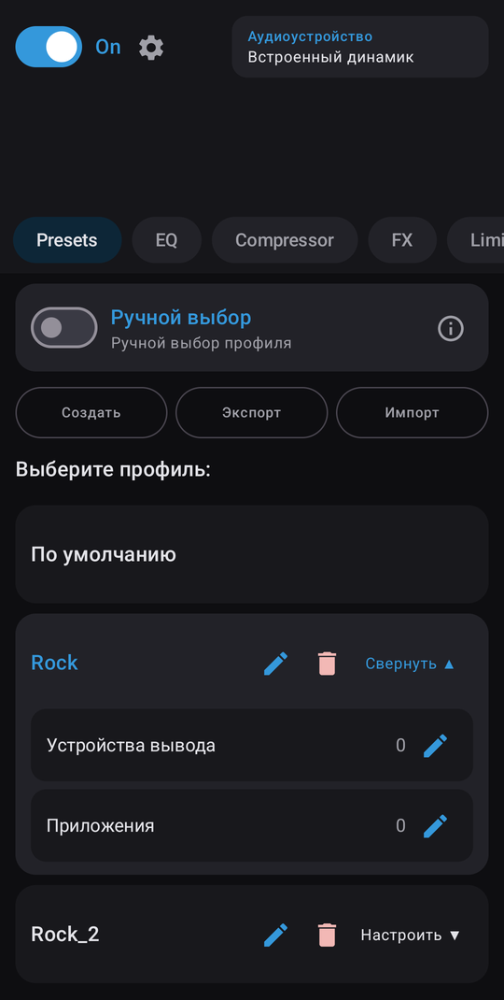
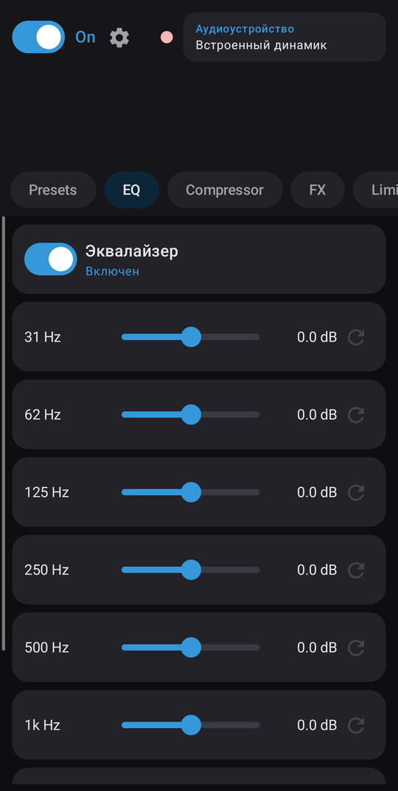
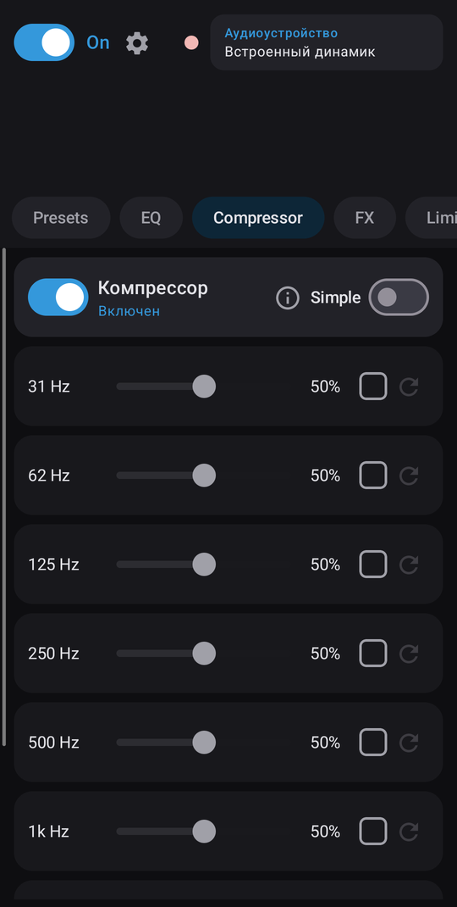
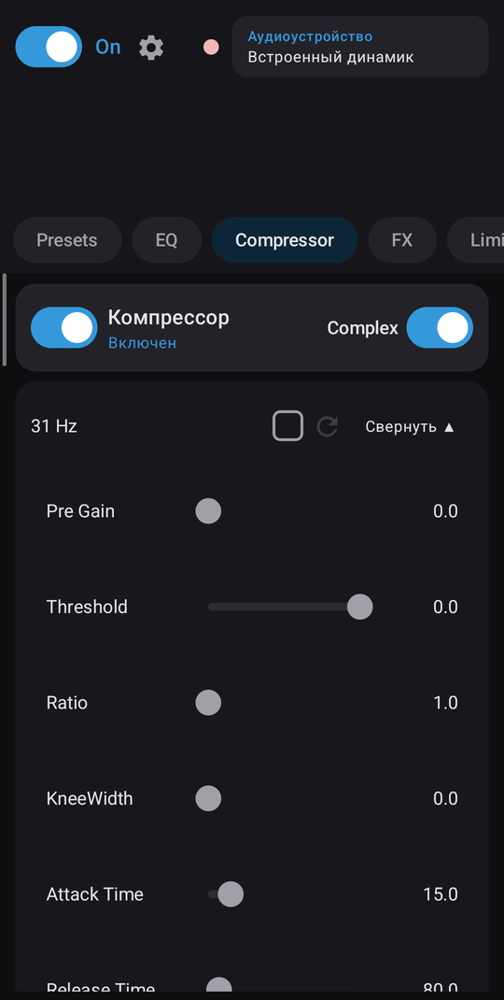
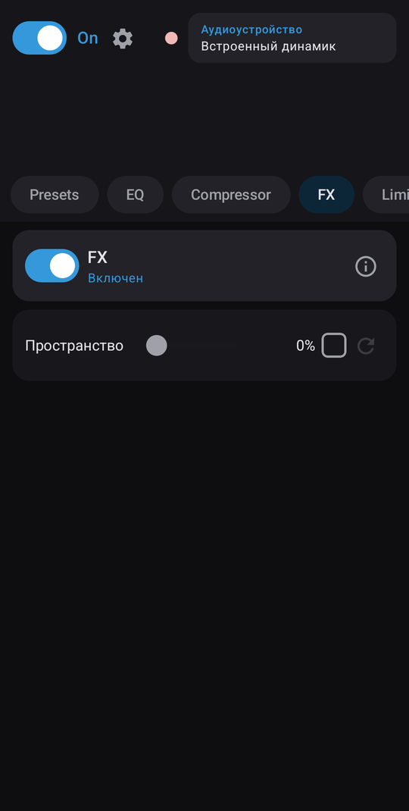
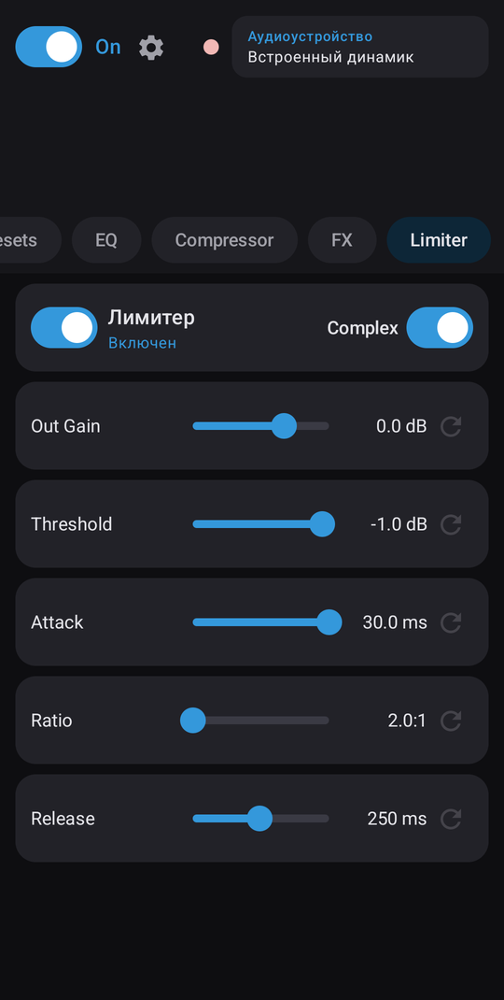
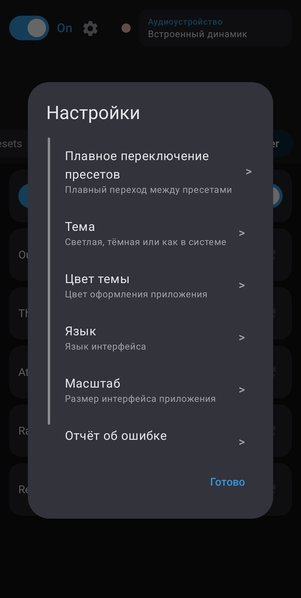
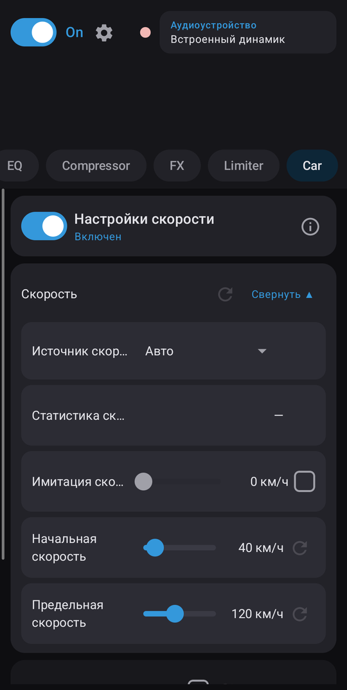
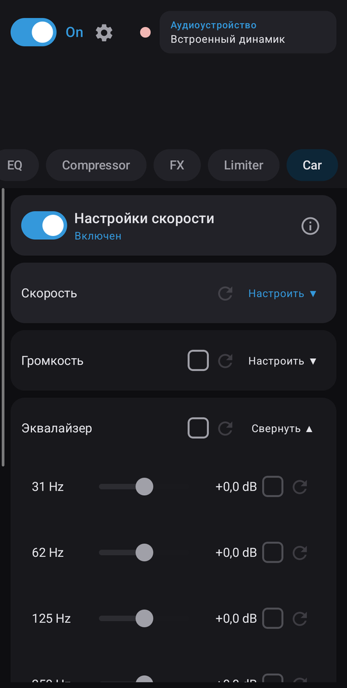

# equX

[English](README.md) | **Русский**

Системный эквалайзер и DSP для Android-смартфонов и автомобильных головных устройств (ГУ) на Android.
Root не нужен.

equX применяет цепочку эффектов к глобальной аудиосессии (session 0), поэтому работает с любым
плеером, в том числе с приложениями, которые не открывают собственную сессию аудиоэффектов.

## Возможности

- **Эквалайзер**: параметрический пост-EQ с настройкой частоты и усиления каждой полосы.
- **Компрессор**: многополосная обработка динамики. В режиме *Simple* — один слайдер интенсивности на полосу, в режиме *Complex* — порог, ratio и усиления для каждой полосы.
- **Лимитер**: защита выхода от перегрузки (brickwall), тоже с режимами Simple и Complex.
- **FX**:
  - *Пространство*: системный виртуализатор + подъём верхов 1–16 кГц.
  - *Тонкомпенсация*: на малой системной громкости поднимает бас и верха по кривым равной громкости ISO 226:2003. Настраиваются сила и порог громкости, подъём ограничен +12 дБ.
- **Пресеты**: сохранение, переименование, импорт и экспорт в JSON. Опционально — плавный переход между пресетами.
- **Автопереключение**: выбор пресета по активному устройству вывода (динамик, проводные наушники, Bluetooth, USB), играющему приложению и, на ГУ, по подключённому телефону-источнику.
- **Car** (только на ГУ):
  - *GALA*: повышение системной громкости с ростом скорости.
  - *Скоростной EQ*: плавный подъём выбранных полос с ростом скорости.
  - *Источники скорости*: vendor-служба ECARX, Android Automotive VHAL или GPS. Слайдер имитации скорости позволяет проверить настройки на стоянке.
- Плитка в быстрых настройках, автозапуск при загрузке, визуализатор спектра.
- Темы, цвета акцента и масштаб интерфейса (ГУ с низким `densityDpi` определяются автоматически).
- Языки: English, Deutsch, Nederlands, Русский, 日本語, 中文.

## Скриншоты

| Пресеты | Эквалайзер | Компрессор | Компрессор (Complex) |
|---|---|---|---|
|  |  |  |  |

| FX | Лимитер (Complex) | Настройки |
|---|---|---|
|  |  |  |

| Car: скорость (ГУ) | Car: скоростной EQ (ГУ) |
|---|---|
|  |  |

## Требования

- Android 10 (API 29) или новее.
- Аудиофреймворк устройства должен поддерживать `DynamicsProcessing` на session 0. Большинство современных смартфонов и ГУ поддерживают.

## Совместимость с головными устройствами

Аудиоэффекты (EQ, компрессор, лимитер, FX) используют только стандартные API Android и одинаково
работают на смартфонах и ГУ. Функции вкладки Car зависят от того, что предоставляет конкретное ГУ:

| Функция | Как работает | Где работает |
|---|---|---|
| Источник скорости: **ECARX** | Vendor-служба ECARX `car_signal` (`ecarx.car.IECarXCar`) | ГУ на платформе ECARX (группа Geely и родственные марки) |
| Источник скорости: **VHAL** | Android Automotive `CarPropertyManager`, `PERF_VEHICLE_SPEED` | Android Automotive OS, если разрешение `CAR_SPEED` выдаётся сторонним приложениям |
| Источник скорости: **GPS** | Скорость от GPS через `LocationManager` | Любое устройство с GPS и разрешением на геолокацию |
| GALA: **Android API** | `AudioManager`, `STREAM_MUSIC` | Большинство устройств |
| GALA: **Android Car API** | Группы громкости `CarAudioManager` | Android Automotive OS |
| Запуск при включении зажигания | `BOOT_COMPLETED`, `USER_PRESENT`, `com.syu.ms.action.ACC_ON` | Большинство ГУ; на некоторых нужно разрешить автозапуск в системных настройках |

Режим *Авто* выбирает первый источник, от которого приходят данные (ECARX → VHAL → GPS). Зелёный,
серый и красный индикаторы на вкладке Car показывают, какие источники и методы громкости работают на вашем ГУ.

Проверено на:

- Geely FX11_J: ГУ на платформе ECARX (QTI G636, Android 11)
- vivo X100 Pro (китайская версия)

Вашей машины нет в списке или что-то не работает? Создайте
[отчёт о совместимости ГУ](../../issues/new?template=head_unit_report.yml).

## Разрешения

| Разрешение | Для чего |
|---|---|
| `RECORD_AUDIO` | Визуализатор спектра (API `Visualizer`). Ничего не записывается и не сохраняется. |
| `MODIFY_AUDIO_SETTINGS` | Применение аудиоэффектов; регулировка громкости GALA. |
| Доступ к уведомлениям (опционально) | Определение активного плеера для автопереключения. |
| `ACCESS_FINE_LOCATION`, `ACCESS_BACKGROUND_LOCATION` (опционально) | Источник скорости GPS на вкладке Car. |
| `BLUETOOTH_CONNECT` | Определение Bluetooth-устройств вывода и телефонов-источников. |
| `MANAGE_EXTERNAL_STORAGE` (опционально) | Встроенный файловый менеджер для импорта и экспорта пресетов. |
| `android.car.permission.CAR_SPEED` | Скорость автомобиля через Car API (выдаётся только на ГУ, которые это разрешают). |

equX не подключается к сети и не собирает никаких данных.

## Сборка

Нужны Android Studio или JDK 17+ (для запуска Gradle wrapper) и Android SDK.
Сам демон Gradle работает на JDK 25 (`gradle/gradle-daemon-jvm.properties`); если его нет, Gradle скачает его автоматически.

```sh
./gradlew assembleDebug
```

Версия хранится в `version.properties`. APK называется `equx_<версия>-<тип сборки>.apk`.

Автоповышение версии (опционально): добавьте `equx.autoVersion=true` в `local.properties` (или передайте
`-Pequx.autoVersion=true`), и каждая сборка `assemble*` или `bundle*` будет увеличивать `versionCode` и
patch-часть `versionName`. По умолчанию выключено, чтобы обычные сборки не меняли файлы под git.

### Подпись release

Создайте `keystore.properties` в корне проекта. Он указан в `.gitignore` — никогда не коммитьте его.

```properties
storeFile=/path/to/release.jks
storePassword=...
keyAlias=...
keyPassword=...
```

Без этого файла release-сборки подписываются debug-ключом.

### Тесты

```sh
./gradlew testDebugUnitTest          # unit-тесты
./gradlew connectedDebugAndroidTest  # UI smoke-тесты (нужно устройство)
```

## Структура проекта

```
app/src/main/java/com/xz3t/equX/
  audio/     DSP-движок (DynamicsProcessing, Virtualizer, Visualizer)
  data/      модель пресета, хранение в DataStore, сканеры устройств и приложений, выбор пресета
  service/   foreground-служба, монитор скорости, управление громкостью в авто, плитка QS
  receiver/  приёмники загрузки и аудиосессий
  ui/        экраны и компоненты Jetpack Compose
carstubs/    compile-only заглушки OEM-классов Car API (в APK не попадают)
```

Car API и vendor-службы вызываются через рефлексию, поэтому один и тот же APK работает и на обычных смартфонах.

## Лицензия

[MIT](LICENSE)
